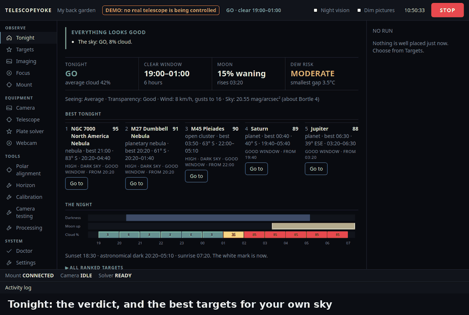
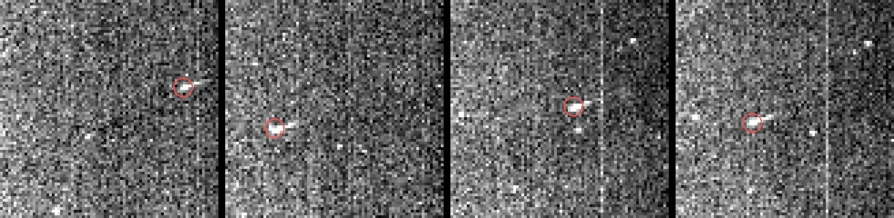
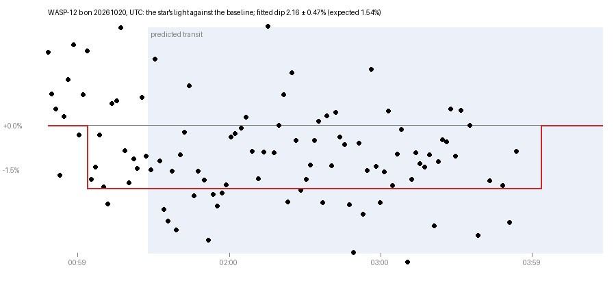
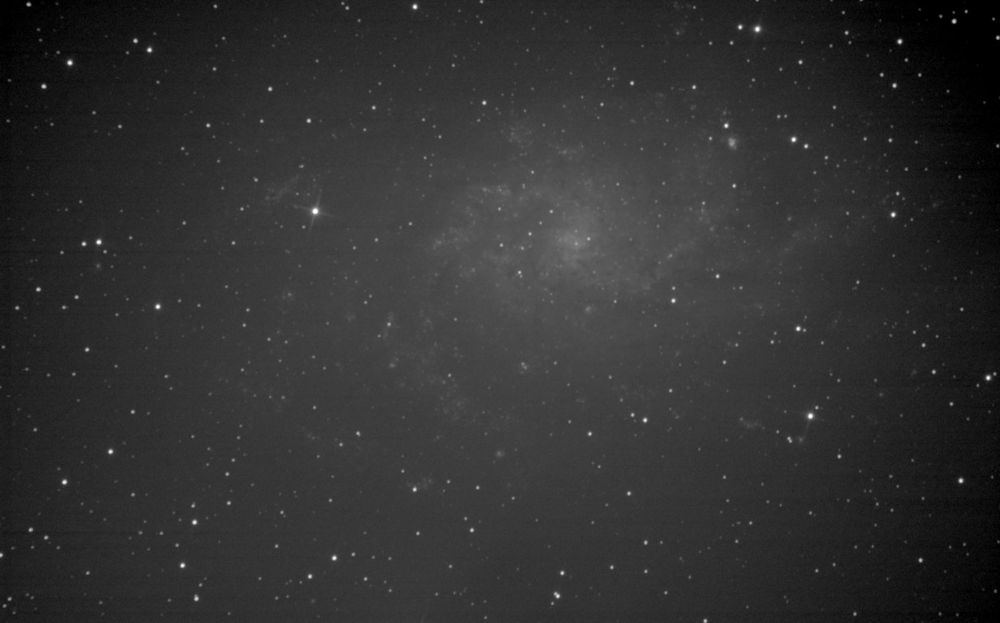
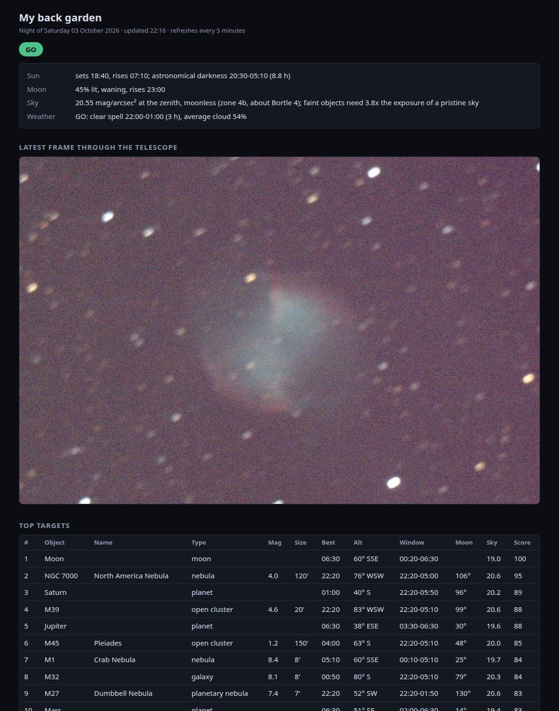
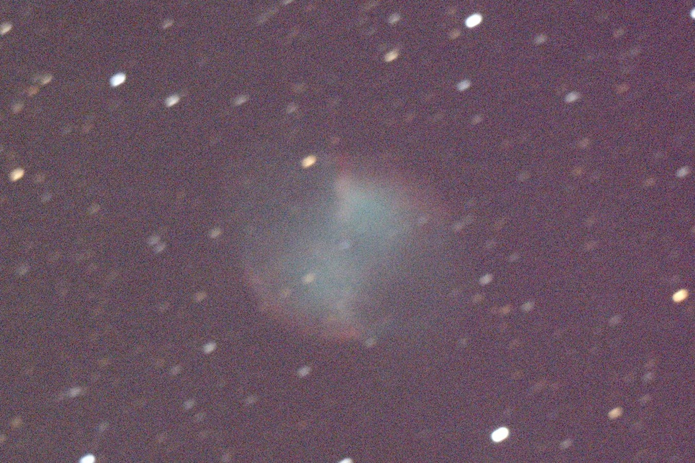

# telescopeyoke 🔭

**A self-measuring robotic observatory and discovery station for affordable GoTo mounts, run by a person and an AI agent together.**



*The demo, recorded by `./tour.py`. These are not mocked-up screens: a
complete pretend rig is built in (mount, camera, sky, focuser, cloud, drift),
and the real centring, focusing and stacking code runs on it.*

**[Home page](https://ryan-clinton.github.io/telescopeyoke/) ·
[Download 0.2.1](https://github.com/Ryan-Clinton/telescopeyoke/releases/download/v0.2.1/TelescopeYoke-v0.2.1.zip) ·
[Try the demo, no telescope needed](#quick-start) ·
[Results](docs/results.md) ·
[What it has been tried on](docs/hardware.md) ·
[All the docs](docs/README.md) ·
[Ask a question](https://github.com/Ryan-Clinton/telescopeyoke/discussions)**

telescopeyoke takes the kind of GoTo mount many amateur astronomers already
own, starting with Sky-Watcher's SynScan family, and adds what much bigger
systems do. It measures its own pointing, polar alignment, focus, drift,
camera timing and image depth, and corrects for them; plans and runs a
whole night; searches its pictures for novae and new transients, and public
archives (spacecraft coronagraphs, Kepler and TESS light curves, radio SETI
recordings) for what is strange; tells you when something matters, on your
phone or through the house's lights and speaker; and can explain the night
live to an audience. An AI agent can operate it beside you, by one rule:
**AI proposes; deterministic code decides what is safe; a person decides
what the telescope does.**

It is built around one idea: **measure the imperfections of modest
equipment instead of pretending they are not there.** A home position set
by eye, a manual focuser, a rough polar alignment, a garden with a house in
the way: each is measured, and then corrected or planned around.

It runs on the author's EQ3 Pro today; other mounts are welcome, and
[Mounts](docs/mounts.md) says which are planned. It is an Ubuntu
application. It also runs natively on Windows, where the demo runs and the
camera has taken frames, but no mount has been driven yet.

> **New to motorised telescopes?** Start with
> **[From box to first galaxy](docs/first-night.md)**: a first night, step by
> step, with no knowledge of polar alignment, RA and Dec, plate solving or
> astrophotography assumed.

> **Looking for testers.** So far it has run on one telescope: the author's
> EQ3 Pro. If you have an EQ3, EQ5, HEQ5 or EQ6 with a SynScan handset, on
> Linux or Windows, a report from you is worth more than any new feature.
> You do not have to let it move your mount: `./doctor.py --report` only
> looks at what is connected. See [Hardware](docs/hardware.md#to-add-a-row).

## The observatory at a glance

```
OBSERVE   plan → schedule → GoTo and centre → focus → image → hold → park
MEASURE   pointing · polar error · true home · drift · focus · shutter · depth · precision
DISCOVER  patrol → subtract → vet → second look → follow night to night → report
RESEARCH  comets in coronagraph pictures · Kepler and TESS dips · radio SETI
OPERATE   cloud and rain · stopped runs · alerts by phone, lights and speaker
REASON    JSON for every command · ty · MCP · skills and specialist agents
SHARE     status page · public live page · YouTube and Twitch broadcast with a presenter and chat
```

## What it has done

Each of these is recorded in [the validation record](docs/validation.md);
[Results](docs/results.md) gives each one's method and limits.

- **3 October 2026:** first light; a GoTo from a home set 10° out by eye
  centred by plate solving in three corrections.
- **13 October:** polar alignment measured and corrected from 3.3° to 0.1°.
- **17 October:** the true home found from 10.66° out to 0.19°, one
  pointing correction per side shown to be enough, and the garden's skyline
  measured by the telescope itself.
- **19 October:** the six-hourly comet hunt found a known Kreutz sungrazer by
  itself in live GOES-19 coronagraph pictures.
- **20 October:** live on Twitch; a first exoplanet transit attempt on
  WASP-12 b, rejected by its own measurement as not a detection, and the
  reasons found and worked on the same day.
- **1-2 November:** live on YouTube; the polar measurement shown to repeat
  to 0.06-0.11°; a subtraction fix cut the nova patrol's false candidates
  from 23 to 5.
- **3 November:** the Kepler archive search found Tabby's star's four known
  dips and nothing else; 16 leads from it looked into, none yet a discovery.
- **4-5 November:** the cooled mono camera's first night: held at -5 °C all
  session, seven filters, plate solves in 0.3 s, and M33 in 34 minutes.

| Discovery | Science | New camera |
|---|---|---|
|  |  |  |
| A known Kreutz sungrazer the hunt found by itself in GOES-19 coronagraph pictures, 19 October 2026 | The first exoplanet transit attempt, WASP-12 b, 20 October 2026: dimming seen, not a detection | M33 from the 183M's first night, 4-5 November 2026: 126 frames of 16 s in L, darks only, no flats yet |

**Why it is unusual.** No one of these functions is new. What is unusual
is that one inexpensive amateur rig combines measuring its own faults,
robotic observing, searches for new objects with their vetting, research in
public archives, AI-agent workflows, alerts in the house and a public
science broadcast, and keeps physical safety outside the language model.
Its failures are kept as carefully as its successes: a transit that was
not a detection says so, and why.

## What it does

**Observe**

- 🌙 **Plans tonight's observing**: darkness, Moon, and a GO / MARGINAL / NO-GO verdict, with the discovery programmes timed into the clear spell
- 🗓️ **Runs the whole night** (`schedule.py`): the agreed steps in order, not before their times; a failed step stops the rest and fetches you; at the end it parks the mount and tells you (each piece proven; a whole night ended by it alone, not yet)
- 🧭 **Plate-solves and centres GoTos automatically** (`goto M27 --solve`)
- 🔭 **Controls SynScan mounts** through the handset, with the handset's clock errors corrected
- 📷 **Captures and stacks images**: every raw frame kept, poor frames rejected, stars lined up to a fraction of a pixel, satellite trails clipped out, and the whole stack rebuilt from the raw frames afterwards
- ❄️ **Runs a cooled mono camera and filter wheel**: cooled slowly once and held cold all night (`keeper.py`), several filters and targets in one cold session (`shoot.py --blocks`), a colour picture from L, R, G and B (`colour.py`; the first real try failed, its fix not yet rerun)
- 🎯 **Holds a transit's target on the same pixels all night** (`shoot.py --hold`), learning how the mount answers first (simulator only so far)

**Measure** ([what makes it different](docs/features.md))

- 📐 **Measures the polar alignment**, by night from three plate solves, and says which way to turn each adjuster; before dark from Polaris alone is experimental (not yet found by day)
- 🧮 **Makes the best of a rough polar alignment**: predicts the drift it causes anywhere in the sky and creeps a motor against it
- 🔊 **Focuses**: with a motor focuser by itself, or by ear with your hand on the knob: a click and a tone for every frame, and a few words at the turning points
- 📏 **Measures itself**: the true home, the pointing on each side, the camera's real shutter time and stripes, how deep each picture reaches (planted fake stars) and how precise its photometry is
- 🎯 **Ranks targets for your actual sky**: altitude, moonlight, light pollution, and your own skyline, measured from a phone panorama or by the telescope

**Discover** ([the discovery station](docs/discovery.md))

- 🌌 **Patrols M31 and M33 for novae**: subtracts a reference, vets every candidate against catalogues, asteroids and a classifier trained on its own pictures, takes a second look, and follows candidates from night to night
- ☄️ **Hunts comets in spacecraft pictures** every six hours, checks each find against the planets, bright stars and the Sungrazer Project's reports, and says what it turned out to be
- 🪐 **Measures exoplanet transits and variable stars**, with the verdict before any fitted number
- 🔁 **Searches public survey alerts and its own old pictures again** as its methods improve, and prepares a report packet for a person to check and send

**Research without the telescope** ([archive](docs/archive.md), [leads](docs/research/README.md), [SETI](docs/seti.md))

- 📉 **Searches Kepler's and TESS's light curves for stars like Tabby's** (`archive.py`), ruling out the spacecraft's own events and eclipsing binaries
- 🔎 **Looks into each lead by one fixed procedure** (`investigate.py`) against Gaia, SIMBAD and VSX, and says whether it is explained, an artefact or unexplained, and whether this telescope could watch it
- 📡 **Searches Breakthrough Listen's open radio data** for narrowband signals (`seti.py`), with the ON-OFF cadence test that tells interference from the target, a few blocks of the band each cloudy day

**Operate** ([alerts](docs/alerts.md))

- ☁️ **Checks cloud, rain, wind, dew and seeing**, from the forecast and from its own frames, plus a live satellite cloud picture
- 📱 **Tells you what matters, by the right channel**: candidates, comets and the end of the night on Telegram with the evidence; for hands now, every light in the house, a spoken sentence on a speaker, and your phone
- 🛑 **Keeps the mount inside physical limits**, with a motion lock, the handset's state checked before each move, and moves checked against what the camera saw

**Reason** ([for programs and AI agents](docs/agents/README.md))

- 🤖 **Built to be operated with an AI agent**: every command answers in one JSON shape, `ty` is one front door, the web API and MCP server are read-only, and skills and specialist agents hold the routines

**Share** ([streaming](docs/streaming.md))

- 🏠 **Shows it all on a status page** you can watch from indoors, and a public live page with the place left out
- 📺 **Broadcasts the night live on YouTube and Twitch**: the stack building up, what the object is and why it matters, a presenter that explains the method, cards between targets, and chat commands that let viewers ask but not operate
- 🧪 **Has a complete pretend rig built in**: the demo runs the real centring, focusing and imaging code against a simulated mount, camera and sky

Every script and what it does: [Commands](docs/commands.md).

## A person and an AI, together

**AI proposes; deterministic code decides what is safe; a person decides
what the telescope does.** An AI agent (the author uses Claude) can read
everything the observatory knows, plan a night, investigate a candidate and
propose the next step: fourteen skills hold the routines (setup at the
telescope, focusing, polar alignment, a discovery night, a claim, a comet
report) and seven specialist agents do focused jobs (vetting a candidate,
researching a place in catalogues, checking a comet track, reviewing a
change that moves the mount, analysing a night). What may move is decided by
code that does not depend on the agent: the Sun and altitude limits, the
motion lock, the handset's state, dry runs, moves checked against the
camera, and hooks that refuse any attempt to work round them. The MCP server
and web API are read-only, every agent action is logged, and every move is
one the person asked for, or part of a night's plan they agreed.
[AGENTS.md](AGENTS.md) has the detail.

It learns from real nights: a comet split in two by a gap in the pictures
became joined tracks and a checked verdict by noon the next day; a transit
that could not be measured became a precision diagnosis, a hold on the same
pixels and a recipe the same day; a colour picture whose filters drifted
apart became a refusal (`FRAMES_APART`) and a fix by morning.

## See it working

**Planned.** This is what `./serve.py` shows, to watch from indoors:
tonight's verdict and the targets worth pointing at, ranked for your sky.



**Found.** A real run from the first night. The mount's home position had
been set by eye and was about ten degrees out; the telescope photographed the
sky, worked out where it really was, and corrected itself:

```
$ ./mount.py goto M27 --solve
M27 Dumbbell Nebula: altitude 57°, hour angle +0.36 h (west: a swing over the pole if it is on the east side now)
  off by -107.0' in hour angle, +94.4' in Dec
  off by -6.2' in hour angle, -11.4' in Dec
  off by +1.0' in hour angle, -1.8' in Dec
  centred
```

**Captured.** The Dumbbell Nebula (M27) from that night: 48 two-second
exposures through a 150 mm Newtonian on an EQ3 mount that was polar aligned
by eye.



## Quick start

**Try the demo: no telescope, nothing to set up, nothing that can move.**

On Ubuntu or Debian:

```bash
wget https://github.com/Ryan-Clinton/telescopeyoke/releases/download/v0.2.1/TelescopeYoke-v0.2.1.zip
unzip TelescopeYoke-v0.2.1.zip
cd TelescopeYoke-v0.2.1
./install.sh --demo           # the Python libraries, then TelescopeYoke (demo) opens
```

On Windows 10 or 11: install 64-bit Python 3.11 or newer from python.org
(tick "Add python.exe to PATH"),
[download TelescopeYoke-v0.2.1.zip](https://github.com/Ryan-Clinton/telescopeyoke/releases/download/v0.2.1/TelescopeYoke-v0.2.1.zip),
unpack it, and double-click **`try-demo.cmd`**.

That zip is release 0.2.1, which stays as it is; a hardware report says
which release made it. `git clone https://github.com/Ryan-Clinton/telescopeyoke`
gets the newest code instead, which changes from day to day.

Either way a window opens on a pretend mount, camera and sky: a GoTo is
centred by plate solving, the focusing aid follows a focuser you turn with
a button, and an imaging run stacks frames and rejects the ones taken after
you bring the cloud over. It runs the same commands as a real night and
keeps its files in a folder of its own (`demo/`), apart from anything real.
It is in the applications menu (or Start Menu) from then on as
**TelescopeYoke (demo)**.

The same from a terminal, a piece at a time:

```bash
./doctor.py                   # what is installed and connected
./tonight.py --demo           # tonight's report with made-up weather
./serve.py --demo             # the web page, on http://localhost:8080
./mount.py --demo goto M27    # drive a simulated mount
```

On Windows these are written `python doctor.py`, `python tonight.py --demo`
and so on, and `.\ty.cmd` (or `python ty`) for `./ty`. See
[Setup](docs/setup.md#windows).

**The application.** `./install.sh` puts **TelescopeYoke** and **TelescopeYoke
(demo)** in the applications menu (on Windows, `install.ps1` puts them in the
Start Menu). It opens in a window of its own, with no terminal and no
browser: Tonight, Targets, Imaging, Focus and Mount for observing; Camera,
Telescope, Plate solver and Webcam for setting the equipment up; the tools;
and the doctor, settings and logs. With a real mount, a move you make in
the application is checked with a dry run and shown as a plan, and goes
only when you confirm it. A night's schedule you have agreed runs its own
moves, each through the same limits and dry runs.
From a terminal it is `./app.py`, or `./app.py --demo`. It has not yet been
used with a real mount or camera.

**Use the planner for real** (still no telescope needed): put your location
in `config.toml`, then `./tonight.py`.

**Run a telescope:** `./install.sh`, then follow [Setup](docs/setup.md).

## Hardware

It has driven one mount, the author's, with two cameras:

| Mount | Camera and optics | System | What has worked |
|---|---|---|---|
| Sky-Watcher EQ3 Pro, SynScan handset 3.35 | Explorer 150P; Altair Hypercam 183C (colour) | Ubuntu 26.04 | ✅ Planner, mount moves, camera, focusing, plate solving, GoTo with centring, polar alignment, imaging, under real stars |
| the same | the same | Windows 11 | ⚠️ The demo, and camera frames indoors. No mount driven |
| the same | 150P with a 0.9x coma corrector (675 mm); Altair Hypercam 183M PRO TEC (mono, cooled); Starlight Xpress 7-position filter wheel | Ubuntu 26.04 | ✅ First night 4-5 November 2026: cooled to -5 °C, darks, every filter, plate solving, polar alignment, M33 in L. ❌ No flats yet, the motor focuser cannot lift it, the first colour picture to be retaken |
| EQ5, HEQ5, EQ6 with SynScan, or yours | any | Linux or Windows | ❔ wanted: [send a report](docs/hardware.md#to-add-a-row) |

[Hardware](docs/hardware.md) has the full table, what to expect of other
equipment, a probe for EQMOD-style controllers, living beside EQMOD and
ASCOM, and running more than one telescope.

## Safety

The laptop cannot see what the telescope is about to hit.

- **Start the handset properly.** After every power-on, press ENTER through
  the handset's start-up screens to its main menu, entering today's date. A
  handset still on its version screen accepts commands but moves the mount by
  the wrong amounts. `mount.py` refuses to run if the handset's date is still
  its default.
- **Power on in the home position**: counterweight bar at the lowest point of
  its swing, tube on top, pointing at the pole.
- **Keep the tripod legs clear** and leave slack in the cables. Targets west
  of the meridian swing the tube over the pole.
- **The mount's word is checked where a camera can check it.** If a
  correction changes nothing, or picture after picture is the same though
  the mount was turned, the command stops the mount and refuses with
  `MOUNT_NOT_MOVING`. Then watch one small move yourself: if the tube does
  not turn, switch the mount off and on.
- **Never point near the Sun.** `mount.py point` refuses within 40° of it
  while it is up; `goto` only knows night-sky objects.
- Creating a file called `MOTION_LOCKED` in this folder blocks all movement.
- `mount.py` will not go below 20° altitude or more than 7.5 hours from the
  meridian.
- **A cooled camera is cooled and warmed slowly**, 1 °C a minute, never
  below its set floor, and cooling stops if the cooler fails.
- **Science refuses what it cannot trust**: frames without matching
  calibration, a filter the wheel has not confirmed, a sensor not at its
  temperature, colour from filters that do not overlap.
- **The status page (`serve.py`) is read-only on purpose.** It is served to
  the whole home network with no login, which is fine for pictures and
  reports. Nothing that moves the mount will be added to it.
- **The control console (`console.py`) answers this computer only.** It
  needs a key made each time it starts, shows every move as a plan first,
  and moves the mount only when that plan is confirmed.

## What has been proven

What has been proven, and where. "Real stars" means on the author's EQ3 Pro
and 150P on Ubuntu, at night, with the Hypercam 183C unless the row says
the 183M; "real equipment" means the hardware answered or moved but no star
was involved. Everything is also run against the simulated rig.

| Feature | Under real stars | On real equipment | Simulated rig |
|---|---|---|---|
| Night report and status page | ✅ | ✅ | ✅ |
| Mount moves through the handset, `sync` | ✅ | ✅ | ✅ |
| GoTo centred by plate solving | ✅ to about an arcminute, from 10° out | ✅ | ✅ |
| Polar alignment from three plate solves | ✅ 3.3° to 0.1° over six rounds; it repeats to 0.06-0.11° (1-2 November 2026) | ✅ | ✅ |
| Finding and marking the true home (`findhome`, `truehome`) | ✅ 17 October 2026: from 10.66° out by eye to 0.19° on the marks | ✅ | ✅ |
| Pointing survey: one correction for each side | ✅ 17 October 2026 | ✅ | ✅ |
| Imaging and stacking | ⚠️ runs of 48 and 207 frames, M31 and M33 runs since; long stacks reach a noise floor | ✅ | ✅ |
| The cooled mono camera (183M) and filter wheel | ✅ 4-5 November 2026: held at -5 °C all session with the camera kept open, all seven filters, plate solves in 0.2-0.3 s, M33 in L. ❌ Colour from L, R, G and B: the first try's filters drifted apart (fixed, not yet rerun); filter focus offsets not measured | ✅ | ✅ |
| Focusing: measuring the stars | ✅ the reading fell from 11 to about 2 as focus was reached; HFR 2.0 by hand on the 183M | ✅ | ✅ |
| Focusing: click, tone and three levels | not yet | not yet | ✅ |
| Motor focuser (`focus.py --motor`) | ✅ focused the 150P with the 183C to HFR 2.47 (15 October 2026). ❌ cannot move the 183M's heavier train | ✅ | ✅ |
| Shutter time corrected (`camera.py`) | ✅ a 10 s frame's trails show 9.6 s open, from 6.4 s | ✅ | ✅ |
| Drift model and Dec correction | ⚠️ an earlier, cruder version only | ⚠️ the same | ✅ |
| Daytime Polaris | ⚠️ searched three times, Polaris not found | ⚠️ the search only | ✅ |
| Skyline from a phone panorama | does not need them | ⚠️ three real panoramas; not yet tied to the compass | ✅ |
| The telescope's own skyline survey | ⚠️ by night, a torch trial only | ✅ by day, 17 October 2026: 28 bearings in 34 minutes; 2 November, a second spot's skyline | ✅ |
| Azimuth from a landmark | not yet | not yet | ✅ |
| Control without the handset (Wi-Fi, EQDIR) | not yet | ⚠️ the Wi-Fi adapter read; nothing moved | ✅ |
| The application window | not yet | ⚠️ opened on Ubuntu, in the demo only | ✅ |
| Windows | not yet | ⚠️ camera frames indoors; no mount driven | ✅ |
| Checking that the telescope really turned | not yet | ⚠️ by day: one real record, and it caught a real fault; 109 checked looks on a working mount, none stopped wrongly | ✅ |
| Discovery: subtraction, candidates, vetting | ⚠️ on real M31 and M33 stacks, with planted fakes; no find of our own yet | ✅ | ✅ a known nova found again in ZTF's archive images |
| Comets in spacecraft pictures (`sungrazer.py`) | does not need them | ✅ 19 October 2026: a known Kreutz sungrazer found by the hunt itself in live CCOR-1 pictures | ✅ known comets found in archived LASCO pictures |
| Kepler and TESS archive search (`archive.py`, `investigate.py`) | does not need them | ✅ Tabby's star's four known dips found and nothing else (3 November 2026); 16 leads looked into, none unexplained | ✅ |
| Radio SETI (`seti.py`) | does not need them | ⚠️ 9 of 308 blocks of one cadence searched; planted signals found, no false hits in 240 runs; every candidate so far interference | ✅ |
| Lights, speaker and phone alerts (`alert.py`) | does not need them | ✅ cloud and rain alerts on a real light and speaker; the call that woke the author when a run stopped (20 October 2026) | ✅ |
| Live stream on Twitch and YouTube (`stream.py`) | ✅ Twitch on air 20 October 2026 on the WASP-12 b run; YouTube on air 1 November 2026 | ✅ | ✅ |
| Exoplanet transit photometry | ⚠️ one attempt (WASP-12 b): dimming seen, not a detection | ✅ | ✅ |
| Photometric hold (`shoot.py --hold`) | not yet | not yet | ✅ |
| The night's end: parked and told | not yet | ⚠️ `mount.py home` only | ✅ |
| Several rigs, `--probe` | not yet | not yet | ✅ |
| Dark frames | does not need them | ✅ 183M master darks at -5 °C, 4 November 2026 | ✅ |
| Flat frames, gain sweep | not yet | not yet | ✅ |

**[docs/validation.md](docs/validation.md#current-conclusions) is the one
record of what has been proven**: this table follows its "Current
conclusions", and the account under them says, night by night, what was
tried, what it showed, and what is still a guess. Two things from it that
anyone using the software should know: the 183C exposed for less time
than it was asked (about two thirds at 10 s) until `camera.py` learnt to ask
for more, so stacks from before 13 October 2026 overstate their integration;
and on one night the motors stopped while the handset went on reporting every move
as made. A GoTo with centring, a polar measurement and the skyline survey now
check that the view changed, and stop if it did not; a plain GoTo with no
plate solve still takes the handset's word.

There are no automated tests: what works is what has been seen to work, on
the real rig or in the demo against the simulated one.

Known limits:

- The 183C's frames are slow through INDI on a USB 2 lead (about 4 s plus
  five times the exposure); on the USB 3 lead it has used since 6 October
  2026 a 1 s frame takes about 1.5 s. The 183M adds 0.43 s to each frame.
- After a slew the stars streak for up to half a minute while the gears
  settle; the scripts wait before photographing.
- With a rough polar alignment the aim drifts by an arcsecond or more per
  second, which limits exposures to a couple of seconds.
- The handset's GoTo overshoots right next to the pole, so `home` steers by
  the axis readout instead.
- The target ranking in `tonight.py` uses weights chosen by judgement.

## Roadmap

Next, on the sky (each is in [Validation](docs/validation.md#current-conclusions)
as not yet done):

- Flats for the 183M in each filter, then a colour picture with the
  drift fix in, and a measured depth against the 183C.
- The filter focus offsets proved on the sky (`./focus.py --walk-in --prove-sets`),
  so the narrowband filters can be used without "focus as is".
- A stronger focuser motor for the 183M's train.
- A known nova recovered from this rig's own frames; a transit timed
  against its prediction, with `shoot.py --hold` on the real mount.
- A whole night ended by the runner alone: parked, told, flats taken.
- The click-and-tone focusing under real stars.
- A phone panorama tied to the compass and checked by the telescope;
  daytime Polaris again, now the axis is close to the pole.
- A night with mount and camera together on Windows.

Then:

- Someone other than the author running it. Reports from other SynScan
  mounts come before any new feature.
- Recordings from real nights for this page: a GoTo-and-centre run
  (`--record` and `replay.py` are ready for it) and a focusing session. The
  animation at the top is the demo.
- More of the cameras' quirks moved into `config.toml` as other cameras are tried.

Later, for image quality, in this order: colour calibration from catalogue
stars (the plate solve already identifies them); gentle deconvolution, once
calibration and alignment are proven; sky-gradient removal frame by frame;
drizzle on the 183C's raw Bayer frames. None of these before a controlled comparison has shown what the current
pipeline gains on real data.

Later, if people ask for them:

- Raspberry Pi or other small computer strapped to the telescope.
- Controls on the web page, behind a login.
- Letting an agent request a move over MCP, carried out only after a person
  approves that exact move (designed in `docs/agents/safety.md`, not built).
- The MCP server moved onto the official MCP Python SDK, once MCP is a feature people
  rely on. Today's hand-written one speaks the protocol directly to avoid a dependency;
  the telescope logic stays in `agent.py` either way.
- The agent scenarios in `evals/` run with a real model in the loop.
- Guiding (the guide camera opens; it waits for a guide scope).

Not planned: ASCOM's Windows-only COM interface (Alpaca reaches the same drivers, and is planned: [Mounts](docs/mounts.md)), mobile apps, a React front end, cloud services, Docker images, plugin systems, a sequencing language. Bigger
projects (NINA, KStars/Ekos) do those well; this one stays small, readable,
and aimed at ordinary SynScan gear.

## The documentation

| Page | What is in it |
|---|---|
| [All the docs](docs/README.md) | Every page, sorted by what you came for: trying it, its results, watching it, building with agents. |
| [Results so far](docs/results.md) | Each real result as question, method, result and limits. |
| [From box to first galaxy](docs/first-night.md) | A first night for someone who knows none of the words. |
| [Hardware](docs/hardware.md) | What it has run on, and how to add yours. |
| [Commands](docs/commands.md) | Every script, how they fit together, and a night by hand. |
| [What makes it different](docs/features.md) | Each way it measures and works round modest equipment, with how far each is proven. |
| [Looking for something new](docs/discovery.md) | The discovery station and its phases. |
| [Checking it under real sky](docs/validation.md) | Exactly what has and has not been proven, night by night. |
| [For programs and AI agents](docs/agents/README.md) | `--json`, `--dry-run`, the `ty` command, the web API and the MCP server; start with [AGENTS.md](AGENTS.md). |

## Contributing

Reports from other hardware are the most useful contribution: run
`./doctor.py --report` and paste it into a **Hardware compatibility report**
issue, as [Hardware](docs/hardware.md#to-add-a-row) describes. Questions,
ideas and pictures you have taken go in
[Discussions](https://github.com/Ryan-Clinton/telescopeyoke/discussions).
What each release added is in [CHANGELOG.md](CHANGELOG.md); `./release.py`
makes one. For code, see [CONTRIBUTING.md](CONTRIBUTING.md): run
`ruff check` on what you changed, and try anything that changes how the
mount moves in the demo against `simulator.py`.

## Data sources

Weather: [Open-Meteo](https://open-meteo.com) (its default forecast, checked against the Met Office, ECMWF, DWD ICON and NOAA GFS). Seeing: [7Timer](https://www.7timer.info).
Light pollution: [D. Lorenz's atlas](https://djlorenz.github.io/astronomy/lp/).
Comets: [COBS](https://cobs.si) and [JPL Horizons](https://ssd.jpl.nasa.gov/horizons/).
Bright supernovae: [the Rochester list of active ones](https://www.rochesterastronomy.org/snimages/snactive.html), in `./ty night` and `./tonight.py` when one brighter than magnitude 15.5 is up.
The sky's events and the news: [in-the-sky.org](https://in-the-sky.org), [Universe Today](https://www.universetoday.com) and the [BAA](https://britastro.org), in `./ty night` and `./tonight.py`.
Cloud imagery: [EUMETSAT](https://view.eumetsat.int).
Coronagraph pictures: SOHO's LASCO and GOES-19's CCOR-1.
Light curves: Kepler and TESS, from [MAST](https://archive.stsci.edu).
Radio: [Breakthrough Listen's open data](https://seti.berkeley.edu/opendata).

## Licence

MIT; see [`LICENSE`](LICENSE). The one exception is `data/targets.csv`,
which is derived from [OpenNGC](https://github.com/mattiaverga/OpenNGC) and
is licensed CC-BY-SA-4.0; see [`data/LICENSE`](data/LICENSE).
