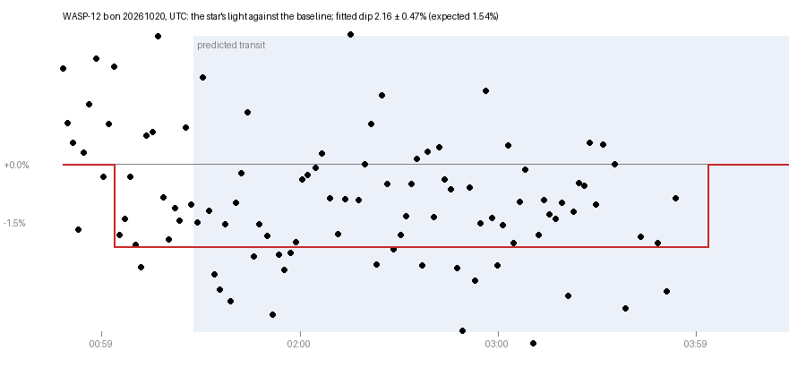

# WASP-12 b, night of 19–20 October 2026: a first transit attempt

The first exoplanet transit this rig has tried to measure. The frames were
taken and the measurement runs end to end, but the result does not stand as
a detection: the photometry has a noise floor of about 20 mmag that does not
improve with brightness, and cloud took the egress. This page sets out what
was taken, what was measured, where the noise appears to come from, and what
would settle it.

*The star's light against its baseline before the transit, one point per 10
frames (40 s of exposure), times in UTC. Shaded: the predicted transit. Red:
the box that fits best. `transit-WASP-12b.json` holds every point.*

## The target

WASP-12 b: a hot Jupiter on a 1.09-day orbit around a G 11.5 star; published
depth 1.54%, duration 3.0 h (from the planet table `transits.py` keeps).
Predicted on this night: ingress 01:27, middle 02:57, egress 04:27 UTC.

## What was taken

- Sky-Watcher 150P (150 mm, f/5) on an EQ3 Pro, Altair Hypercam 183C (Sony
  IMX183, colour), gain 1500, 4 s frames, unguided, no dithering.
- Session `frames/WASP-12/20261020-014726`: 00:47 to 03:59 UTC, 992 frames
  taken, 973 kept (cloud from about 03:50). Three short restarts after
  camera hangs added 45 frames after 04:00 and are not in this curve.
- Calibration: a bias and a 1 s dark at gain 1500. With no dark matched
  to the 4 s frames, the stacking took off the bias alone. **No flat
  frames.**
- Baseline before ingress: about 40 minutes (the BAA asks for at least 30,
  ideally 60). **None after egress**: cloud and camera hangs from 03:50.

## What was measured

`./transits.py measure frames/WASP-12/20261020-014726 --planet "WASP-12 b"`
(variables.py's photometry, run on 20 October after two fixes, b767d8a):

- the kept frames in 99 batches of 10, each batch stacked onto the first
  frame's pixels;
- the stacks plate-solved, every Gaia star of G 11.5 to 16 placed by its
  catalogue position;
- each star's light measured with weights shaped like a star of the first
  stack's width (FWHM 5.2 px, weighting radius 5.2 px), on the stack less a
  smooth background;
- magnitudes put on Gaia G by the night's ensemble, batch by batch, with a
  smooth surface over the field taking out vignetting that moves;
- a box fitted with its middle sought within an hour of the prediction.

Result: **transit-like dimming seen, but not independently measurable**:
the star was not watched after the transit. Exploratory box fit: 2.16 ±
0.47% (expected 1.54%), 89 points inside the box, 10 outside, scatter 15.3
mmag per point outside it; timing unconstrained. The error is conditioned on
the box model and does not cover a slow trend standing in for the missing
baseline. The fit puts the middle
24 minutes early, but with no baseline after the transit an earlier middle
and a deeper dip fit the same points, so the timing is not measured; the
command now says so (cd0ce83). The depth agrees with the published one
within its error, but it rests on ten points before ingress, and a slow
drift over the night would look much the same.

## Where the noise comes from

Every star's scatter about its own median, by brightness (robust, per
10-frame point; removing a smooth quadratic trend changes it by under 1
mmag):

| G | stars | scatter (mmag) |
|---|---|---|
| 11.4–12 | 33 | 22.1 |
| 12–12.5 | 32 | 21.0 |
| 12.5–13 | 45 | 22.9 |
| 13–13.5 | 89 | 27.2 |
| 13.5–14 | 79 | 36.9 |
| 14–15 | 277 | 66.2 |
| 15–16 | 395 | 155.4 |
| WASP-12 (11.5) | 1 | 16.7 |

What it should be for G 11.5 in 40 s through 150 mm: photon noise well under
1 mmag, scintillation about 2 mmag at this airmass (Young's formula). So the
bright stars stop improving at about 20 mmag: a systematic floor, not noise.
The ensemble's common correction per point is 4.7 mmag rms, so it is not the
sky changing for all stars alike.

Measured during the run (`frames.jsonl`):

- the field **drifted up to 80 px in x and y** across the sensor (unguided,
  polar alignment 0.6° low), and **rotated 0.45°**;
- star width 5.6 to 6.3 px (5–95%), so focus and seeing held fairly steady;
- sky background rose from 15 to 36 ADU (haze coming in before the cloud).

## What the diagnosis found

`./precision.py frames/WASP-12/20261020-014726 --planet "WASP-12 b"`: the
973 kept frames measured 288 ways (two stripe treatments × four colour
channels × six apertures × six comparison sets), each frame on its own.
All the figures are in `precision.json` beside the night's frames.

| | per 4 s frame | per 10 frames, before / during | beta | baseline slope |
|---|---|---|---|---|
| best: star-shaped weighting, all colours, the steadiest 20 stars | 40.9 mmag | 13.1 / 13.9 | 1.17 | 40 mmag/h |
| the 10 steadiest, destriped | 42.8 | 13.5 / 14.1 | 1.08 | 35 |
| stars like WASP-12 in brightness and colour | 41.1 | 14.6 / 10.9 | 1.29 | 35 |
| as measured until now (the whole field) | 42.0 | 18.0 / 16.1 | 1.55 | 65 |

Median of the worse of the two scatters over everything else, by each choice:

- **aperture:** star-shaped weighting 21.4, 1 FWHM 22.7, 1.5 FWHM 24.1,
  2 FWHM 24.4, 2.5 FWHM 29.5, 3 FWHM 40.0 mmag;
- **channel:** all four sites 21.3, green 21.4, blue 29.3, red 31.0;
- **stripes:** destriped 25.0, as read 24.6 (no difference);
- **comparison:** like WASP-12 21.7, best 10 22.8, best 5 25.1, best 20
  27.9, nearest 10 28.2, all 29.3.

What it means:

1. **It is not a fixed floor.** Each 4 s frame scatters by about 41 mmag, and
   averaging brings that down nearly as random noise would (beta 1.1 to 1.3
   for the best ways). The "20 mmag floor" in the table above is mostly that
   per-frame noise averaged over only 10 frames; an earlier version of this
   page called it systematic, which was wrong.
2. **The per-frame noise comes from the background round each star.**
   Bigger apertures are worse, steeply, so the sky, read and dark noise in
   the extra pixels outweigh the light gained: in 4 s frames at gain 1500,
   WASP-12 (12,500 ADU in a 2 FWHM aperture) is not bright enough against
   its background. Photon noise and scintillation together should be about
   20 mmag a frame; the measured 41 is about twice that. Longer exposures
   are the remedy the numbers point to (WASP-12 stays linear to about 50 s).
3. **Stripes do not matter here**, and green alone is as good as all four
   sites; red and blue alone are worse (fewer photons).
4. **The comparison stars matter most.** A small set like WASP-12, or the
   steadiest, beats the whole field by about a quarter.
5. **The baseline slopes by 35 to 40 mmag an hour** and follows the airmass
   (correlation about -0.2), as differential colour extinction would. Over
   only 40 minutes of baseline, a box fit cannot tell that trend from a
   transit: the box depth comes out at 2.0 to 2.9% (median 2.5%) whichever
   way it is measured, against the published 1.54%, and none of these is a
   measurement of the planet.

## Suspects, most likely first

Revised after review (20 October 2026), with the expected depth (1.54%,
about 16–17 mmag) no bigger than the scatter per 10 frames (20–22 mmag):
that is why the night is borderline despite nearly a thousand frames. The
diagnosis above has since put short exposures against a noisy background
and the airmass trend first; flats and drift come next, untested until
there are flats.

1. **No flat field, with the stars wandering 80 px.** Each star crosses
   different pixels, dust shadows and vignetting through the night; with no
   flat, the sensitivity it meets changes by a percent or more. The ensemble
   surface takes out smooth vignetting, not pixel-scale or dust-scale
   structure. Fits a floor the same for every star.
2. **A weighting radius of one FWHM.** Only the core of each star is
   measured, so small changes in the star's shape across the field and
   through the night (coma, tilt, the 0.45° rotation, focus) change the share
   of light measured. Typical aperture photometry uses 2–3 FWHM.
3. **The colour sensor.** The stacks are luminance made from debayered
   colour; a star's light on the Bayer pattern changes as it drifts by a
   pixel, and the interpolation in registering each frame onto the first
   adds to it.
4. **Differential colour extinction.** Unfiltered colour pixels see a
   wide band, WASP-12 and the ensemble differ in colour, and the haze
   thickened through the night (the sky rose from 15 to 36 ADU), so the
   atmosphere dims them by different amounts as the airmass and haze
   change. A red filter is the usual remedy.
5. **The comparison ensemble.** Every star brighter than G 16 is in it,
   weighted by the whole field; a smaller set of steady stars near WASP-12's
   brightness and colour would be the usual choice.
6. **Row stripes.** Lowest: the frames are destriped before photometry
   (`stacking.prepare`; an earlier version of this page said otherwise),
   and at WASP-12's brightness what is left is small beside a 20 mmag
   floor.

## What would separate them

All from this night's frames; nothing needs the telescope. `precision.py`
(below) does them all in one pass:

- the scatter against the **weighting radius** (1, 2, 3 FWHM, and a plain
  aperture): if 2–3 FWHM drops the floor, suspect 2;
- the scatter against **how far each star drifted** and against its place
  in the field: if stars near the edge or near dust shadows are worse,
  suspect 1;
- the scatter of each **colour channel** measured on its own, raw, without
  debayering: suspect 3;
- the same with the **rows' median taken off** each frame first: suspect 4;
- WASP-12 against **5–10 hand-picked comparison stars** of G 11–12.5 near it:
  suspect 5.

## What was built from the review

- `./precision.py SESSION --planet "WASP-12 b"`: every kept frame measured
  with round apertures of 1–3 FWHM and the star-shaped weighting; all four
  Bayer sites and red, green and blue alone (2x2 superpixels, nothing
  interpolated); with and without destriping; against all steady stars, the
  best 20, 10 and 5 (ranked on the whole night, not the baseline they are
  judged on), stars like WASP-12 in brightness and colour, and the 10
  nearest. For each way: the scatter before the transit and during it, the
  bright stars' own scatter, the scatter as more frames are averaged and its
  beta, the depth, the baseline's slope, and the correlation with drift, star
  width, sky and airmass.
- `transits.py measure` now leads with the verdict above; gives the scatter
  as points are averaged and beta; names the calibration the frames lacked;
  says how the times were made (DATE-OBS is the exposure's start; the
  frame is kept about 5.3 s later) and gives each point as BJD_TDB; records
  whether the computer's clock was kept to time (`session.json` "clock",
  from shoot.py, since 20 October); and the exposure headroom: WASP-12 peaked
  at 219 of 4095 in the 4 s frames, so frames up to about 50 s keep it
  linear in focus. The 4 s frames were far shorter than they needed to be.
- `transits.py` (tonight) says first which calibration a transit night
  still needs: a flat, and a dark for each exposure (there is no 4 s or 16 s
  dark at gain 1500).
- `shoot.py --hold PX`: the target kept within PX pixels all night. It
  learns each direction of each axis from a short move, then takes back most
  of any wander with small capped moves; no dithering. Not yet tried on the
  real mount.

## The recipe for the next attempt

Flats (20 or more) and darks matched to the exposure → the target held
within a few pixels (`--hold 5`) → slight defocus and longer exposures,
the longest that keeps WASP-12 and the comparison stars linear (10, 15, 20
and 30 s to be tried) → green-channel differential photometry with 5–10
chosen comparison stars → at least an hour of baseline before and after,
the whole transit covered → the aperture and comparison set chosen by
`precision.py` on the baseline's scatter → the scatter's fall with
averaging looked at before any fit. A ~1.5% dip centred near the prediction
with flat baselines on both sides would then be a detection.

## Questions for a reviewer

- Is the ranking of suspects right for an unguided, unflatted colour CMOS
  rig, and is there a cause missing?
- Is 10-frame (40 s) binning sensible here, or would a fit on every frame
  with its own error be better?
- With baseline on one side only, is a fitted depth worth quoting at all,
  or only the drop between the baseline and the first hour?
- What scatter should a rig like this reach on a G 11.5 star, and what do
  amateur transit observers (ExoClock, the BAA, the ETD) usually get?
