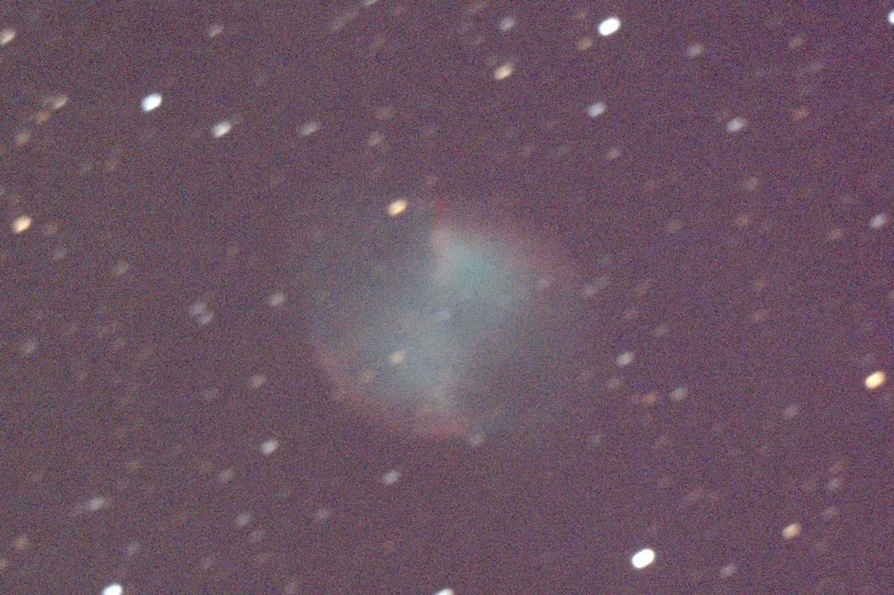
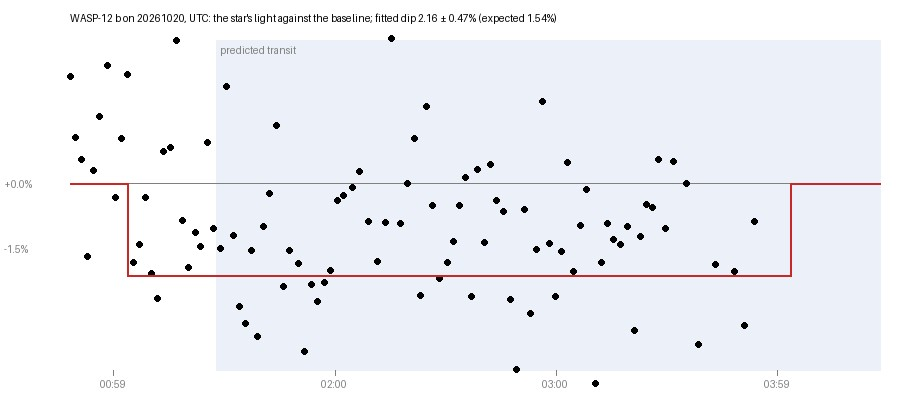
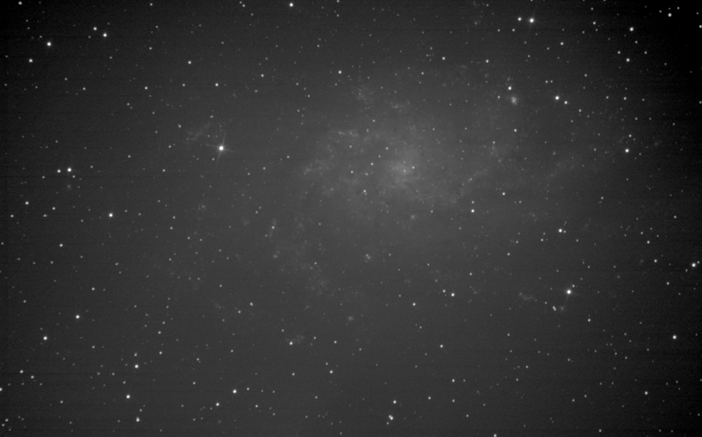

# Results so far

[README](../README.md) · [All docs](README.md) · Guides: [First night](first-night.md) · [Setup](setup.md) · [Imaging](imaging.md) · [Calibration](calibration.md) · [Focus](focus.md) · Science: [Discovery](discovery.md) · [Results](results.md) · [Validation](validation.md) · [Data](data.md) · Developers: [Contributing](../CONTRIBUTING.md) · [Agents](agents/README.md)

Each result below is real, and dated, and says where it falls short. They
are in the same order every time: the question, what it was done with, how,
what came out, and what it does not show. The full account of what is and
is not proven is [Validation](validation.md); the discovery programme's own
record is [docs/discovery/results.md](discovery/results.md).

Each result names its kind of evidence, since they answer different
questions: a **real-sky observation** (this telescope's own frames),
**instrument characterisation** (measuring the rig itself), **archive
analysis** (public data, no telescope of ours), **controlled software
validation** (finding what was planted, so the answer is known) and
**public operation** (it ran in front of people).

None of this is a discovery. The project has found known objects again,
rejected its own weak results, and measured its own equipment; it has not
yet found anything new.

## A GoTo that finds its own way: M27, 3 October 2026

- **Evidence:** real-sky observation.
- **Question:** can a mount whose home was set by eye, about ten degrees
  out, still put a target in the middle of the frame?
- **With:** EQ3 Pro, 150P, Hypercam 183C, on the first night.
- **How:** `./mount.py goto M27 --solve`: photograph, plate-solve, correct,
  repeat.
- **Result:** 107′ off, then 6′, then 1′: centred in three corrections.
  48 two-second frames stacked into the picture on the front page.
- **Limits:** one night, one target. Later nights centred to about an
  arcminute routinely.

## Measuring the mount: polar axis, home and pointing, October to November 2026

- **Evidence:** instrument characterisation, on real stars.
- **Question:** how far is a cheaply set-up mount from right, and can it be
  measured and put right without a polar scope?
- **With:** the EQ3 Pro and plate solves of real stars.
- **How:** `./polaralign.py` (three plate solves), `./mount.py findhome`
  and `truehome`, `./mount.py pointing`.
- **Result:** polar axis from 3.3° to 0.1° in six rounds (13 October);
  repeat measurements with the bolts left alone scattered 0.06-0.11° (1-2
  November). True home found 10.66° out by eye and marked to 0.19°
  (17 October). One pointing correction per side of the meridian is enough
  (17 October: every plate solve within 0.25° of its side's average).
- **Limits:** why a polar reading moved between nights is not known; the
  advice in bolt turns is not yet to be believed.
- **Record:** [Validation](validation.md#current-conclusions),
  [Calibration](calibration.md).

## An exoplanet transit, and why it was not a detection: WASP-12 b, 20 October 2026

- **Evidence:** real-sky observation.
- **Question:** can a 150 mm Newtonian on an EQ3 measure a hot Jupiter's
  transit?
- **With:** the 150P and Hypercam 183C, 973 frames through ingress and the
  middle of the transit.
- **How:** `./transits.py measure`, with its verdict given before any
  fitted number; then `./precision.py` measuring the same frames 288 ways.
- **Result:** dimming of about the right size was seen, and the software
  itself rejected it as a detection: cloud took the baseline after the
  transit, and the photometry was about 14 mmag per 40 s point. The
  diagnosis (short frames against a noisy background, the comparison stars,
  a slope with airmass) became a hold on the same pixels
  (`shoot.py --hold`), calibration warnings and a recipe the same day.
- **Limits:** no transit has yet been timed.
- **Record:** [WASP-12 b, 20 October 2026](discovery/transit-wasp12b-2026-10-20/README.md).

## Novae in M31 and M33: the patrol, October and November 2026

- **Evidence:** real-sky observation, with controlled software validation (planted fakes) and an archive re-detection (ZTF).
- **Question:** can image subtraction on this rig's frames find a nova in a
  nearby galaxy, without drowning in false candidates?
- **With:** the 150P and 183C's M31 and M33 stacks; ZTF's archive images.
- **How:** `./patrol.py`, `./vet.py`, `./realbogus.py`, `./depth.py` with
  fake stars planted to measure what the search finds.
- **Result:** a known nova (AT2024koe) found again in ZTF's archive images;
  planted fakes recovered; the subtraction fix of 1-2 November cut false
  candidates from 23 to 5, and second looks found none real. M31-P8's
  recurring false candidates traced on 4 November to the noise model
  underestimating one patch's noise 1.3-1.9 times.
- **Limits:** no transient of our own yet, and no known nova recovered from
  this rig's own frames.
- **Record:** [discovery results](discovery/results.md),
  [M31-P8, 4 November 2026](nights/2026-11-04/p8-false-candidates.md).

## Stars like Tabby's in Kepler's archive, November 2026

- **Evidence:** archive analysis, a known result found again.
- **Question:** are there other stars that dim like KIC 8462852?
- **With:** Kepler's public light curves (about 150,000 stars, 2009-2013),
  and TESS's; no telescope of ours.
- **How:** `./archive.py` finds dips and rules out the spacecraft's own
  events, gaps and eclipsing binaries; `./investigate.py` looks into each
  lead by one fixed procedure against Gaia, SIMBAD and VSX.
- **Result:** on Tabby's star itself it finds the four dips the discovery
  paper is known for, and nothing else at 1% or deeper (3 November). Of the
  16 leads looked into so far, the most intriguing are red giants whose own
  pulsation likely explains the dips.
- **Limits:** every lead so far is likely explained; none is a discovery.
- **Record:** [the archive search](archive.md), [the leads](research/README.md).

## The cooled mono camera's first night: M33, 4-5 November 2026

- **Evidence:** real-sky observation and instrument characterisation.
- **Question:** does the new train (Altair 183M PRO TEC, Starlight Xpress
  wheel, 0.9x coma corrector at 675 mm) work on the sky, and does it beat
  the 183C?
- **With:** the EQ3 Pro and 150P, the sensor held at -5 °C, master darks at
  -5 °C, no flats yet.
- **How:** `./shoot.py --blocks` in one cold session, the camera kept open
  between blocks so the sensor stayed cold.
- **Result:** M33 in L, 126 frames of 16 s kept (34 minutes), stars aligned
  to 0.24 px, best FWHM 4.7 px: the whole galaxy in frame, with its spiral
  arms and NGC 604. Against the 183C at matched exposure: a wider field, a
  cleaner background, no colour gradient.
- **Limits:** no flats (the vignetting shows), no measured depth
  comparison, and the first colour picture failed because each filter's
  stack had drifted further off; that is fixed in the code and not yet
  rerun.
- **Record:** [the 183M's first night](nights/2026-11-04/183m-first-night.md).

## On air: the live broadcast, from 20 October 2026

- **Evidence:** public operation.
- **Question:** can a night's work be explained live, as it happens, with
  nothing made up?
- **With:** `./stream.py`, Twitch and YouTube.
- **Result:** on Twitch from 20 October 2026 on the WASP-12 b run, in 1080p,
  with the title, category and tags set for each target, the presenter and
  the chat's commands; one 9-minute freeze. YouTube from 1 November.
- **Record:** [streaming](streaming.md).
